# HighRes-EERIE-NorthAtlantic-Evaluation

**North Atlantic circulation and European winter extremes in high-resolution climate models:
ensemble robustness, internal variability and coupled resolution**

[](https://github.com/TunaHim/HighRes-EERIE-NorthAtlantic-Evaluation/actions/workflows/tests.yml)
[](https://tunahim.github.io/HighRes-EERIE-NorthAtlantic-Evaluation/)
[](LICENSE)

**Question.** Which features of the simulated North Atlantic winter circulation and of European
winter extremes are persistent model characteristics, which arise from internal variability, and
how do they change across coupled model resolution configurations? Models from the EU project
[EERIE](https://eerie-project.eu) are evaluated against the ERA5 reanalysis and the station-based
E-OBS dataset over north-west Europe, with the UK and Ireland, western Norway and north-west France
as worked examples.

| Experiment | Question | Data |
|---|---|---|
| **1 · Ensemble robustness: daily extremes and their drivers** | Which biases in circulation, NAO and extremes persist across runs of the same model? | ICON-ESM-ER and IFS-FESOM2-SR, three historical runs each |
| **2 · Internal variability** | How much can chance alone change conclusions drawn from 29 winters? | 100-year control runs of both models; ten-member atmosphere-only ensembles |
| **3 · Resolution** | How do circulation, NAO and winter rain change with resolution? | HadGEM3-GC5E coupled at about 135, 60 and 20 km (atmosphere and ocean together, monthly); IFS atmosphere-only at 28 and 9 km |

**Explore:** [project website](https://tunahim.github.io/HighRes-EERIE-NorthAtlantic-Evaluation/) ·
[interactive explorer](https://tunahim.github.io/HighRes-EERIE-NorthAtlantic-Evaluation/explorer/) ·
[summary notebook](notebooks/00_summary.ipynb) ·
[methods](https://tunahim.github.io/HighRes-EERIE-NorthAtlantic-Evaluation/methods.html)


*The project at a glance. **A, B (experiment 1):** winter very-wet-day rain (R95p) over the UK and
Ireland relative to E-OBS, and NAO strength relative to ERA5, one dot per historical run. **C
(experiment 2):** correlation of winter R95p with the NAO in three regions: shaded, the chance range
from the control runs (5–95% of 29-winter windows); dots, the historical runs; diamonds, E-OBS and
ERA5 with 95% intervals. **D–F (experiment 3):** HadGEM3-GC5E at about 135, 60 and 20 km (ocean 1°,
1/4°, 1/12°): winter pressure error, NAO pattern and strength (pale bars: the two halves of each run),
and UK and Ireland winter rain relative to ERA5.*

> **Read this first.** This is a **research prototype**. Version 1 evaluated a **single run**
> (member r1) of each coupled model. **Version 2** adds two more runs per model, their 100-year
> control runs and a third model at three resolutions, to separate model properties from chance
> (see [Version 2](#version-2-model-or-chance-and-a-resolution-ladder)). The link to extremes still
> rests on 29 winters, so results are indications, not a ranking of the models. The main
> contribution of the project is the **evaluation method and diagnostic pipeline**: a reproducible
> chain of tests that can be rerun on more members, more models, CMIP6 and CMIP7.

**Main message.** Evaluating climate models for regional extremes needs three questions kept
apart: is a feature the same in every run (a model property), could chance in a short record
produce it (internal variability), and does it change with resolution? Large mean-state biases,
such as ICON-ESM-ER's shifted circulation and wet bias, are consistent across the three sampled runs; the NAO link to UK and
Ireland rain extremes is dominated by chance in 29 winters; and a more realistic large-scale
circulation, as at higher HadGEM3-GC5E resolution, does not guarantee more realistic rain. The three
experiments answer different questions and are not combined into one ranking of the models.

---

## Key findings

*Exploratory results. Version 1 used one run per coupled model; version 2 checked the findings
with three runs per model and 100-year control runs. A result found in all three runs is called
robust across the three runs; the numbers below give the version 1 (r1) value with the version 2
range where it differs.*

**The three that matter most**

1. **A biased circulation explains part, not all, of a wet bias.** ICON-ESM-ER's winter pressure is
   too low in the north and too high in the subtropics: its average winter sits 2.1–2.3 SD along
   the NAO, like a permanent strongly positive NAO winter. Multiplied by the observed NAO response,
   that offset is consistent with 38–74% of its very-wet-day rain bias over the UK and Ireland, but
   only 18–39% of its wettest-day bias, mostly on windward coasts and mountains. The rest is a broad
   wet bias that reaches places where such a circulation should make it *drier*: the model rains
   both too often (+34% to +43% wet days) and too hard (+21% to +28% rain per wet day).
   IFS-FESOM2-SR's circulation is close to ERA5 and its rain extremes are within 10–20% of the
   references. The remaining bias suggests that circulation alone does not explain ICON-ESM-ER's
   rainfall, which points to its precipitation frequency, intensity and regional processes. All
   shares come from a linear consistency diagnostic, not a demonstrated cause.
2. **The NAO link to winter rain extremes: consistently too weak over western Norway, chance over
   the UK.** Version 2 shows that over the UK and Ireland the link varies between runs of one model as
   much as between models and references (ICON-ESM-ER 0.06–0.49, IFS-FESOM2-SR 0.21–0.60 over
   three runs), so a single run cannot rank the models there. Over western Norway, by contrast,
   all six runs and every 29-winter window of both 100-year control runs have a weaker link than
   observed (0.81), although the observed value's own 95% interval (about 0.71–0.91) reaches the
   models' strongest windows: a consistent but modest discrepancy. ICON-ESM-ER's wrong sign over north-west France appears in its control run and two of
   three historical runs: its control run almost never produces the observed positive link.
3. **Higher resolution is not automatically better.** In the same model with the same ocean, 9 km
   instead of 28 km makes winter rain extremes 5–12% heavier: closer to observations over the
   mountains of western Norway, too heavy over the UK and Ireland. The NAO link over the UK and
   Ireland varies more between identical 28 km runs (correlation 0.04 to 0.33) than between
   resolutions (9 km: 0.19). **Internal variability matters as much as resolution.**

**Further findings**

4. **Both models have a weaker NAO than the real world** (59% and 71% of ERA5's strength; in
   version 2, 0.55–0.63 and 0.68–0.81 over three runs each, and never above 0.95 in any 29-winter
   window of the control runs).
   *Strength* is the standard deviation of each dataset's winter pressure anomalies projected onto
   the ERA5 leading EOF, divided by the same quantity for ERA5: one common pattern and scale for
   all, not each model's own EOF or its variance explained. Ten
   identical atmosphere-only runs vary between 70% and 100%, so part of this is chance; ICON-ESM-ER
   lies below that whole range. In run r1 ICON-ESM-ER's leading pattern mixes the NAO with a
   second mode (in all five North Atlantic domains tested), but in runs r2 and r3 it resembles
   ERA5's closely, so the mixing was largely chance. Every model is measured along the common ERA5
   pattern; the strengths are robust to the domain (0.56–0.61 and 0.68–0.72).
5. **Both models bring their heaviest UK winter rain through the right weather:** a deep low just
   north-west of the islands (pattern correlation 0.94–0.95 with ERA5). ICON-ESM-ER's storms show
   less build-up in the days before. Both models show 13–17% higher winter variability of the
   day-to-day pressure change over the UK than ERA5, indicating enhanced synoptic storminess (a
   proxy; individual cyclones are not tracked).
6. **The references themselves carry uncertainty.** E-OBS and ERA5 agree on patterns but not
   always on numbers: the NAO link over the UK and Ireland has a correlation of 0.51 in E-OBS and
   0.35 in ERA5, a difference that is within sampling noise for 29 winters.
7. **No detectable change in NAO strength under the tested small-scale SST filtering** in two
   ten-member atmosphere-only ensembles (changes of −1% and +4%, well within the member spread).
   This tests atmospheric sensitivity to SST forcing only, not coupled ocean-eddy feedbacks.

---

## Version 2: model or chance, and a resolution ladder

Version 2 tests version 1 with the extra public data (notebooks 10–12):

| Test | Data | What it showed |
|---|---|---|
| **Three runs per coupled model** ([notebook 10](notebooks/10_members.ipynb)) | ICON-ESM-ER and IFS-FESOM2-SR r1, r2, r3 | Mean-state and extreme-index biases, the wet-day statistics and the too-weak NAO are the same in all three runs: **consistent across the three sampled members**. The NAO link over the UK and Ireland varies by chance. ICON-ESM-ER's mixed NAO pattern was largely run r1's chance. |
| **100-year control runs** ([notebook 11](notebooks/11_control.ipynb)) | both coupled models, constant 1950 forcing, 71 windows of 29 winters | No window reaches the observed NAO strength or the observed NAO link over western Norway; ICON-ESM-ER almost never produces the observed link over north-west France. The control ranges understate chance (several historical runs fall outside them). |
| **One coupled model at three resolutions** ([notebook 12](notebooks/12_hadgem_resolution.ipynb)) | HadGEM3-GC5E at about 135, 60 and 20 km, ocean 1° to 1/12°, monthly | Across the tested coupled configurations the mean winter pressure error falls (3.2, 2.7, 2.6 hPa) and the NAO pattern correlation increases; NAO strength does not change beyond chance; UK and Ireland winter-mean precipitation (not daily extremes) is 25% above ERA5 at 20 km. |

| | |
|---|---|
| 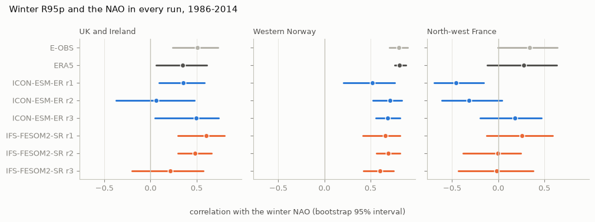 | 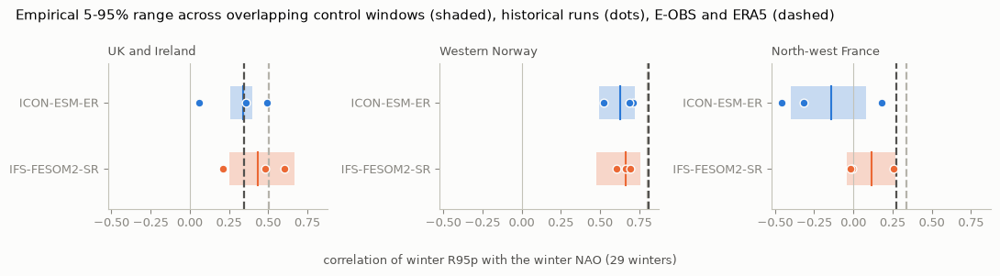 |
| **Winter R95p–NAO correlation in every run, with bootstrap 95% intervals** (notebook 10). | **Chance range from the control runs (shaded), historical runs (dots), E-OBS and ERA5 (dashed)** (notebook 11). |
| 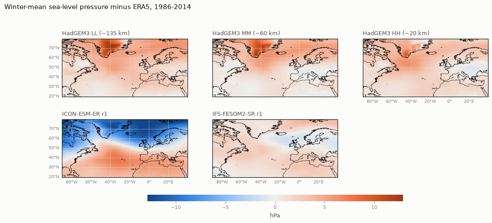 | 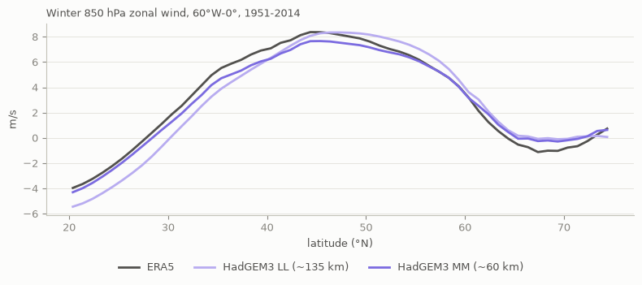 |
| **Winter-mean pressure minus ERA5: HadGEM3 at three resolutions, ICON-ESM-ER, IFS-FESOM2-SR** (notebook 12). | **Winter 850 hPa westerly wind against latitude: ERA5 and HadGEM3 LL and MM** (notebook 12). |

HadGEM3's daily data, needed for its extremes, are not public (they require a JASMIN account), so
the resolution ladder covers the circulation, the NAO, winter-mean rain and the jet only.

---

## Figures

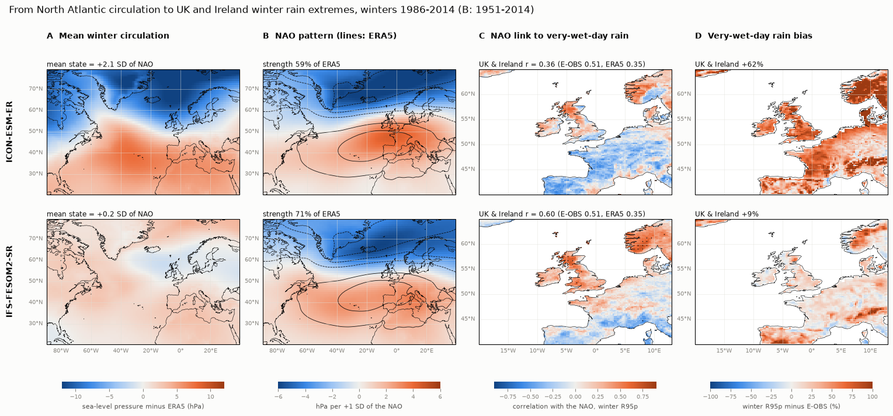

*Read each row from left to right. **A** Average winter sea-level pressure minus ERA5, and that
difference expressed as an NAO state. **B** The model's NAO pattern (colours) against ERA5's (black
lines), and its strength relative to ERA5. **C** Correlation of winter very-wet-day rain (R95p) with
the NAO; dots: significant after false-discovery-rate control. **D** Winter R95p relative to E-OBS.
ICON-ESM-ER (top) has a strongly biased circulation, a weak NAO, a misplaced rain response and
62% more winter R95p than E-OBS over the UK and Ireland (regional land average, 1986–2014).
IFS-FESOM2-SR (bottom) generally represents the circulation and the rain extremes more
realistically, although its NAO is too weak (71% of ERA5's strength) and its southern pressure
centre is weaker and displaced. Winters 1986–2014 (B: 1951–2014); run r1 of each model (experiment 1).*


| | |
|---|---|
| 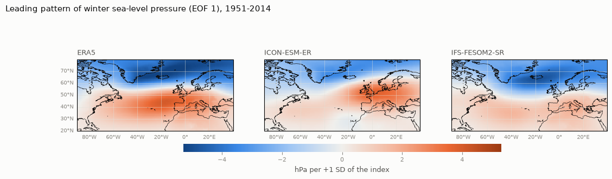 | 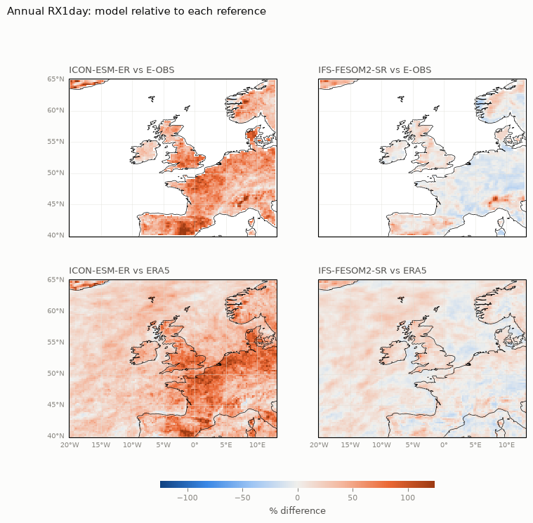 |
| **The NAO in ERA5 and both models** (notebook 04). Blue: lower pressure in a positive-NAO winter. | **Wettest day of the year, model relative to E-OBS** (notebook 05). Orange: too wet. |
| 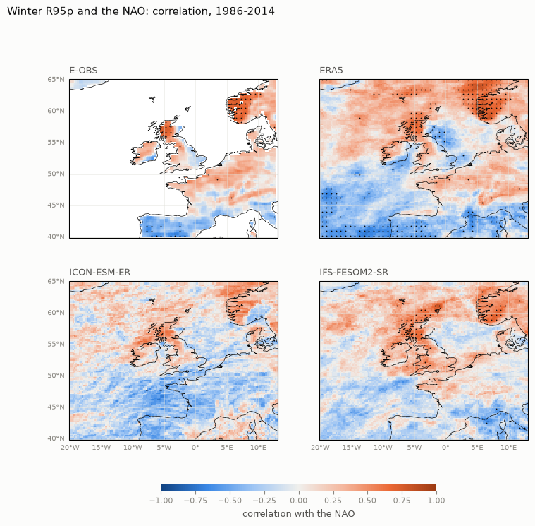 | 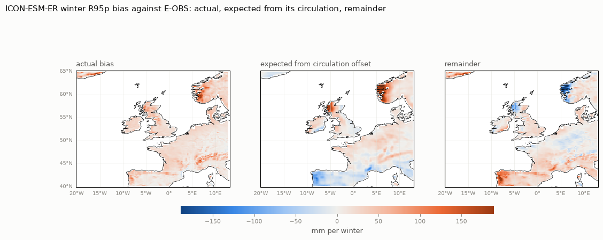 |
| **Correlation of winter very-wet-day rain with the NAO** (notebook 06). Dots: significant after false-discovery-rate control. | **ICON-ESM-ER's very-wet-day rain bias: actual, expected from its circulation offset, remainder** (notebook 06). |
| 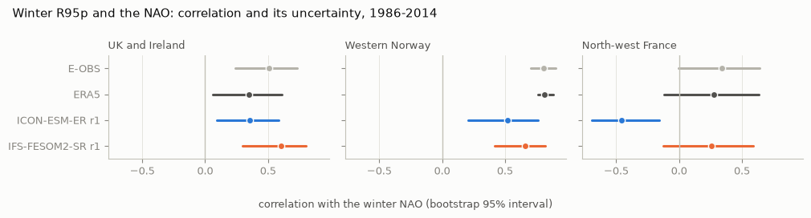 | 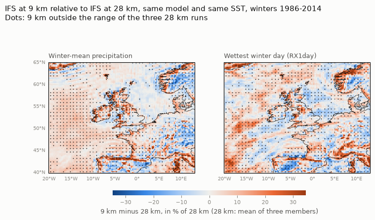 |
| **Correlation of winter very-wet-day rain with the NAO, with bootstrap 95% intervals** (notebook 06). | **9 km relative to 28 km, same model and ocean** (notebook 08). Dots: outside the 28 km member range. |
| 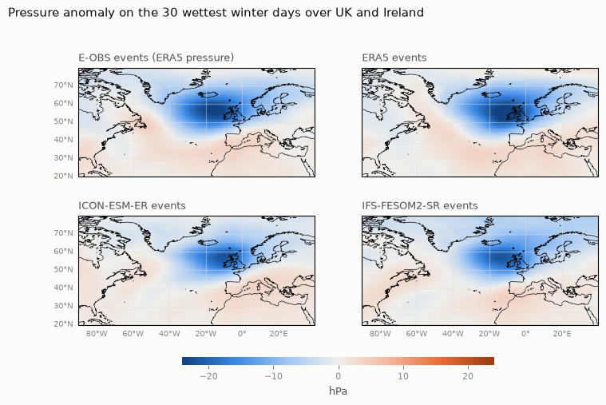 | 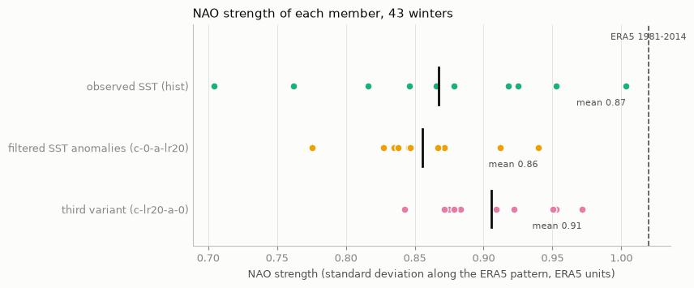 |
| **Pressure anomaly on the 30 wettest winter days over the UK and Ireland** (notebook 09). | **NAO strength of every member of three ten-member ensembles** (notebook 07): the spread is chance. |

---

## Status: a research prototype, and where it could go

This repository is a **research prototype**: a complete, tested chain from public data to
conclusions, run on what one laptop and the public EERIE archive allow (two coupled models with
three runs each and their control runs, a third model at three resolutions, 29 winters of daily
data). It is built so that the same chain can be scaled up, not
as a final evaluation of the EERIE models.

**Scientific scope**

| Step | What it would add |
|---|---|
| More members of the same models | version 2 uses three per model; ten or more would turn the remaining "chance" results, such as the NAO link over the UK, into firm ranges |
| More models: other EERIE configurations, HighResMIP, CMIP6, CMIP7 | places the two EERIE models in a multi-model spread, and tests whether resolution matters across models |
| Longer daily records (1950 onwards) | more winters for the NAO-to-extremes link, which is the most sample-limited result |
| Rain-producing processes | wet-day frequency and intensity by weather type, convective against large-scale rain, to explain the wet bias the circulation does not |
| Summer and other drivers | heat extremes, persistent highs and the East Atlantic pattern next to the NAO |
| Physical climate storylines | using the heavy-rain event composites to ask how such a winter would look under further warming |

**Technical scope**

| Step | What it would need |
|---|---|
| Run next to the data (DKRZ Levante, JASMIN) instead of streaming to a laptop | the same analysis code with a different catalogue backend; `src/eerie_uk/jasmin.py` already reads the public JASMIN catalogue of the Met Office HadGEM3-GC5E EERIE runs, a third model |
| Parallel processing of many members and models | Dask distributed on the cluster, one task per dataset and year |
| CMIP6 and CMIP7 input | a reader that maps their variable names onto the CMIP-style names already used here |
| More robust statistics | moving-block bootstrap, conservative regridding of precipitation, cyclone tracking instead of the storminess proxy |
| Automated reruns | the existing GitHub Actions tests plus scheduled notebook execution on a cluster when new data appear |

The engineering page shows how each part of the pipeline would change:
[How it is built](https://tunahim.github.io/HighRes-EERIE-NorthAtlantic-Evaluation/engineering_overview.html).

---

## Where to start

| If you have | Read |
|---|---|
| 5 minutes | the summary figure and key findings above |
| 15 minutes | [`notebooks/00_summary.ipynb`](notebooks/00_summary.ipynb): the single entry point: question, overview figure, the three experiments and the conclusions |
| a visual overview | the [project website](https://tunahim.github.io/HighRes-EERIE-NorthAtlantic-Evaluation/): what was done and found, and how the data gets from the data centre to the notebooks |
| your own questions | the [interactive explorer](https://tunahim.github.io/HighRes-EERIE-NorthAtlantic-Evaluation/explorer/): maps and yearly series of every extreme index, for each dataset and region, in the browser |
| an hour | the core notebooks below |

**Core story**

| Notebook | Question |
|---|---|
| [`03_validation_baseline`](notebooks/03_validation_baseline.ipynb) | Is the mean winter climate credible? |
| [`04_nao`](notebooks/04_nao.ipynb) | Is the NAO realistic in pattern and strength? |
| [`05_extremes`](notebooks/05_extremes.ipynb) | Are RX1day, TXx and R95p realistic? |
| [`06_nao_extremes`](notebooks/06_nao_extremes.ipynb) | Do the models link the NAO to extremes as the real world does? |
| [`08_resolution`](notebooks/08_resolution.ipynb) | Does 9 km resolution improve winter rain extremes over 28 km? |
| [`09_event_anatomy`](notebooks/09_event_anatomy.ipynb) | What weather brings the heaviest winter rain? |
| [`10_members`](notebooks/10_members.ipynb) | Version 2: model or chance? Three runs of each coupled model |
| [`11_control`](notebooks/11_control.ipynb) | Version 2: how much can chance alone do? Control runs |
| [`12_hadgem_resolution`](notebooks/12_hadgem_resolution.ipynb) | Version 2: HadGEM3-GC5E at three resolutions |

**Background and checks**

| Notebook | Content |
|---|---|
| [`01_data_inventory`](notebooks/01_data_inventory.ipynb) | Which public EERIE data exist and can be read |
| [`02_download_plan`](notebooks/02_download_plan.ipynb) | Domains, datasets, periods, measured download cost, sample maps |
| [`07_paired_experiment`](notebooks/07_paired_experiment.ipynb) | NAO sensitivity to filtered sea-surface temperature |

Every notebook opens with a plain-language explanation of the terms it uses, has a note above every
code cell and a caption under every figure, and ends with findings, limitations and open questions.

---

## Data

| Source | Role | Period |
|---|---|---|
| ICON-ESM-ER, `hist-1950`, r1 (MPI-M) | coupled model, eddy-rich ocean | 1950–2014 monthly; 1985–2014 daily |
| IFS-FESOM2-SR, `hist-1950`, r1 (ECMWF, AWI) | coupled model, eddy-rich ocean | 1950–2014 monthly; 1985–2014 daily |
| IFS atmosphere-only, observed and filtered SST (ECMWF) | sensitivity experiment, 10 members at 28 km | 1980–2023 monthly |
| IFS atmosphere-only at 9 km and 28 km | resolution comparison (1 and 3 members) | 1985–2014 daily (28 km: winter) |
| ERA5 (Copernicus / ECMWF) | reanalysis reference | 1950–2014 monthly; 1985–2014 daily |
| E-OBS v33.0e (ECA&D) | station-based reference over land | 1985–2014 daily |
| Version 2: ICON-ESM-ER and IFS-FESOM2-SR `hist-1950` r2, r3 | extra coupled runs | 1975–2014 monthly; 1985–2014 daily |
| Version 2: ICON-ESM-ER and IFS-FESOM2-SR `eerie-control-1950` | control runs, constant 1950 forcing | 1950–2049 monthly; daily rain |
| Version 2: HadGEM3-GC5E LL, MM, HH `historical` r1 (Met Office, via CEDA) | one coupled model at three resolutions | 1950–2014 monthly |
| Version 2: ERA5 zonal wind at 850 and 250 hPa | reference for the jet | 1950–2014 monthly |

Model and ERA5 data are read from the DKRZ km-scale cloud (`eerie.cloud.dkrz.de`, Zarr over HTTPS);
E-OBS from the ECA&D distribution, HadGEM3 from the public CEDA archive. Only regional cut-outs
are kept (about 12 GB in total with version 2); the data
are not part of this repository and can be re-downloaded with the commands below.

**Domains.** North Atlantic (90°W–40°E, 20–80°N) for the NAO; north-west Europe (20°W–13°E,
40–65°N) for temperature, precipitation and extremes; UK and Ireland (11°W–2.5°E, 49–61°N) as the
headline region, with western Norway and north-west France as the wet and dry sides of the NAO
rainfall pattern.

**Why these data.** ICON-ESM-ER and IFS-FESOM2-SR are the only public EERIE coupled runs with all
the daily and monthly fields needed. IFS-NEMO-ER provides monthly fields only; the HadGEM3-GC5E
resolution ladder requires a JASMIN login. The full reasoning is in
[`docs/methods.md`](docs/methods.md) and notebooks 01 and 02.

---

## Methods in brief

Fixed in [`docs/methods.md`](docs/methods.md) before results were produced.

- **Winter** is December–February, labelled by the year of its January.
- **NAO:** leading EOF of winter sea-level-pressure anomalies over the North Atlantic, √cos(latitude)
  weighting, sign fixed (positive = low near Iceland, high near the Azores). Models are also measured
  along the ERA5 pattern, and checked against a station-style Azores-minus-Iceland index.
- **Extremes (ETCCDI):** RX1day (wettest day), TXx (hottest day), R95p (total rain on days above the
  local 95th percentile of wet days, base period 1985–2014), each per year and per winter.
- **NAO-to-extremes link:** detrended correlation and regression maps, two-sided t-test with
  false-discovery-rate control across grid points (Wilks 2016), composites with bootstrap intervals.
- **Fair comparison:** all datasets on the same 0.25° grid; regional averages over the same land
  cells; units mm/day, °C and hPa.
- **Chance:** judged from the spread between ensemble members wherever members exist.

---

## How it is built

```
DKRZ cloud (STAC + Zarr) ─┐
ECA&D (E-OBS netCDF) ─────┼─► find ─► read, decode, cut, harmonise ─► local archive ─► analysis library ─► notebooks
public catalogues ────────┘   catalogue.py   download.py, grib.py, regions.py   store.py   nao, extremes, events, ...
```

- **Data layer** (`src/eerie_uk/`): `catalogue.py` lists and describes datasets; `download.py` cuts
  each year to the region in memory, converts units and saves compressed netCDF, with retries and
  resume; `grib.py` decodes the IFS GRIB chunks; `regions.py` handles regional cut-outs and regridding;
  `store.py` reads the archive back with common time stamps and units.
- **Analysis layer:** `climatology.py`, `nao.py`, `extremes.py`, `relationships.py`, `events.py`,
  `plotting.py`. Pure functions on xarray data: the same code runs on a model, a reanalysis or
  station data, and on one member or a whole ensemble.
- **Presentation layer:** `scripts/build_notebook_NN.py` generates each notebook, which is then
  executed top to bottom, so text, numbers and figures always come from the code.
- **Tests:** offline tests (`pytest`) on synthetic data with known answers, run automatically on
  GitHub for every push (`.github/workflows/tests.yml`).
- **Provenance:** every result table in `app_assets/` has a JSON file of the same name (and the
  same record inside the Parquet file) giving the code version (git commit), date, input datasets
  with their server version tags, period and method section.

A pictorial version, including how the pipeline would scale to more members, CMIP6/CMIP7 and
supercomputers, is in [`docs/engineering_overview.html`](docs/engineering_overview.html).

---

## Reproduce

```bash
conda env create -f environment.yml          # Python 3.11, xarray, dask, zarr, cartopy, ...
conda activate eerie-uk-nao
pytest                                       # offline tests

# download the regional cut-outs (about 12 GB on disk with version 2; much more is streamed)
$env:PYTHONPATH = 'src'                      # PowerShell; cmd: set PYTHONPATH=src; Linux/macOS: export PYTHONPATH=src
python -m eerie_uk.download --group monthly
python -m eerie_uk.download --group daily
python -m eerie_uk.download --group resolution
python -m eerie_uk.download --group pressure
python -m eerie_uk.eobs
# version 2
python -m eerie_uk.download --group members
python -m eerie_uk.download --group control
python -m eerie_uk.ceda --resolution LL MM HH --variable psl pr tas
python -m eerie_uk.ceda --resolution LL MM --variable ua
python scripts/fetch_era5_wind.py

# rebuild and execute every notebook, then the website (Windows; on Linux/macOS use pwsh)
conda run -n eerie-uk-nao powershell -NoProfile -ExecutionPolicy Bypass -File scripts/build_all.ps1
conda run -n eerie-uk-nao python scripts/export_figures.py
conda run -n eerie-uk-nao python scripts/build_explorer_data.py
conda run -n eerie-uk-nao python scripts/build_site.py
```

**What can be checked without downloading anything**

| Without data | How |
|---|---|
| the analysis library and its tests | `pytest` (offline; the same suite runs on GitHub Actions on every push) |
| every result, figure and number | the executed notebooks in `notebooks/` (also on the website), run top to bottom |
| the result tables | `app_assets/*.parquet`, each with a `.json` provenance record (code version, inputs, period) |
| the explorer | `docs/explorer/data.json`, the data behind the interactive page |

Rerunning the analysis itself needs the regional cut-outs (about 12 GB on disk with version 2; version 1 alone about 4 GB from roughly 250–300 GB
of network traffic to create them).

Downloads resume where they stopped: each year is a separate file, and existing files are skipped.
The server sends whole-globe chunks, so the network traffic (roughly 250–300 GB for everything) is
far larger than what is kept; a connection without a data limit is needed.

---

## Repository layout

```
src/eerie_uk/      analysis and data-access library
notebooks/         executed notebooks 00–12
scripts/           notebook generators, findings text, build script
tests/             offline tests
docs/              methods, visual overviews, figures
app_assets/        small result tables (Parquet), each with a JSON provenance record
environment.yml    conda environment
data/              downloaded cut-outs (not in the repository)
```

---

## Limitations

- Three historical members per coupled model (version 2; one in version 1), 29 winters for the
  link to extremes. Results consistent across three members can still differ in a fourth.
- Control-run chance ranges come from overlapping windows of one 99-winter run and understate
  chance; IFS-FESOM2-SR's NAO strength differs between the two halves of its control run.
- Daily extremes for two coupled models only. HadGEM3-GC5E is evaluated with monthly data, one
  member per configuration, and its atmosphere and ocean resolutions change together.
- Model complexity is not tested.
- ERA5 precipitation is a model product; E-OBS smooths intense rain and covers land only.
- Reference data are regridded bilinearly, not conservatively.
- The resolution comparison uses one 9 km run and three 28 km members, winter only, at 25 km.
- The filter used in the sea-surface-temperature experiment ("LR20") is not documented publicly.
- Air quality is not analysed; persistent high pressure is used only as a circulation proxy.

---

## Data credits and terms

- **EERIE model output:** produced by the EERIE consortium (MPI-M, ECMWF, AWI and partners), served
  by DKRZ. ICON-ESM-ER data are licensed CC BY 4.0 by MPI-M; see each dataset's metadata for terms.
  HadGEM3-GC5E EERIE runs: Met Office, served by the CEDA archive; see the files' metadata for terms.
- **ERA5:** Hersbach et al. (2020), Copernicus Climate Change Service; served by DKRZ.
- **E-OBS:** Cornes et al. (2018), doi:10.1029/2017JD028200. Non-commercial research and education
  use only (ECA&D data policy). We acknowledge the E-OBS dataset and the data providers in the ECA&D
  project.

---

## How to cite

Himansu Kesari Pradhan (2026). *HighRes-EERIE-NorthAtlantic-Evaluation: winter extremes, the NAO and
high-resolution climate models.* https://github.com/TunaHim/HighRes-EERIE-NorthAtlantic-Evaluation

Citation details are in [`CITATION.cff`](CITATION.cff) (GitHub's "Cite this repository" button uses it).

## Licence

Code: MIT (see [`LICENSE`](LICENSE)). Data remain under their providers' terms (above).

## Author

Himansu Kesari Pradhan. Exploratory project, 2026.
