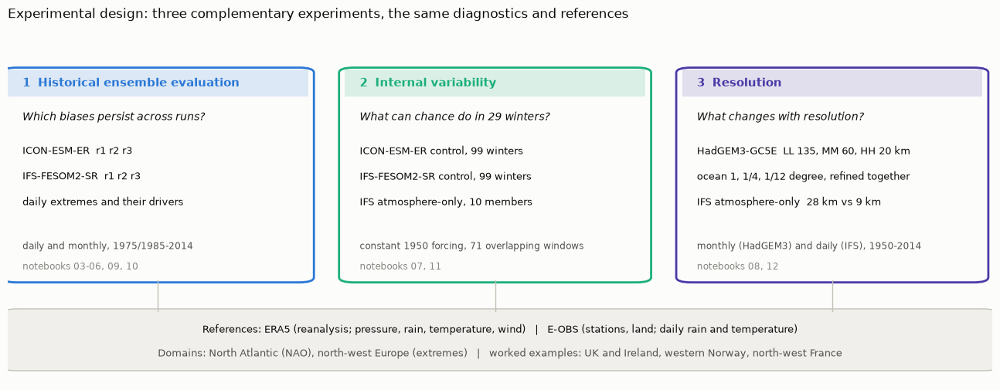
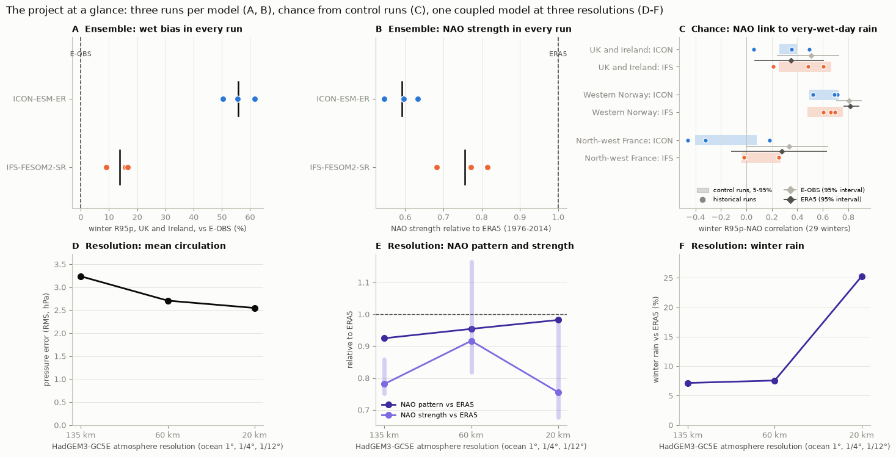
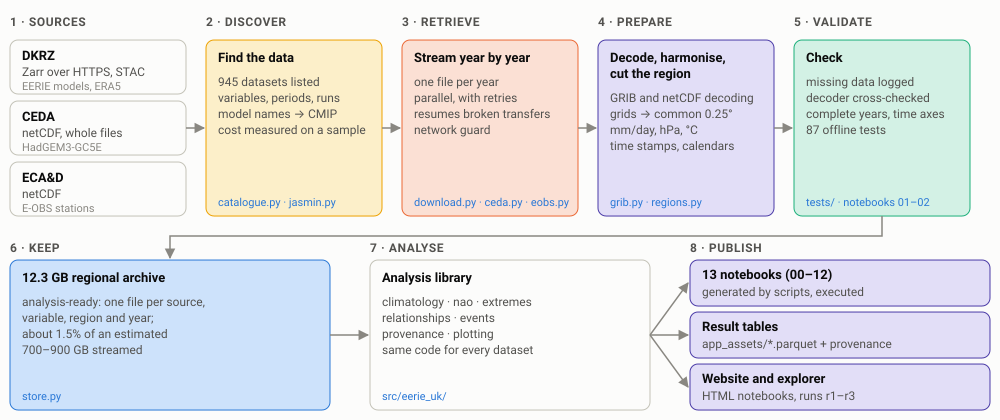

# HighRes-EERIE-NorthAtlantic-Evaluation

**North Atlantic circulation and European winter extremes in high-resolution climate models:
historical ensemble evaluation, internal variability and coupled resolution sensitivity**

[](https://github.com/TunaHim/HighRes-EERIE-NorthAtlantic-Evaluation/actions/workflows/tests.yml)
[](https://tunahim.github.io/HighRes-EERIE-NorthAtlantic-Evaluation/)
[](LICENSE)

**Question.** Which features of the simulated North Atlantic winter circulation and of European
winter extremes are persistent model characteristics, which arise from internal variability, and
how do they change across coupled model resolution configurations? Models from the EU project
[EERIE](https://eerie-project.eu) are evaluated against the ERA5 reanalysis and the station-based
E-OBS dataset over north-west Europe, with the UK and Ireland, western Norway and north-west France
as worked examples.

| | |
|---|---|
| **Website** | [what was found](https://tunahim.github.io/HighRes-EERIE-NorthAtlantic-Evaluation/) — results, figures and the evidence for every finding |
| **Explorer** | [interactive maps and series](https://tunahim.github.io/HighRes-EERIE-NorthAtlantic-Evaluation/explorer/) of every extreme index, runs r1–r3 |
| **Methods** | [methods page](https://tunahim.github.io/HighRes-EERIE-NorthAtlantic-Evaluation/methods.html) — definitions fixed before the results |
| **Engineering** | [how it is built](https://tunahim.github.io/HighRes-EERIE-NorthAtlantic-Evaluation/engineering_overview.html) — data pipeline, data inventory, scaling |
| **Notebooks** | [`notebooks/00_summary.ipynb`](notebooks/00_summary.ipynb) is the entry point; all 13 [on the website](https://tunahim.github.io/HighRes-EERIE-NorthAtlantic-Evaluation/notebooks/) |
| **Posters** | two A0 PDFs, [scientific](posters/poster_science.pdf) and [engineering](posters/poster_engineering.pdf) — the project on one page each ([on the website](https://tunahim.github.io/HighRes-EERIE-NorthAtlantic-Evaluation/posters/)) |

## Experimental design



| Experiment | Question | Data | Notebooks |
|---|---|---|---|
| **1 · Historical ensemble evaluation** | Which biases in circulation, NAO and extremes persist across runs of the same model? | ICON-ESM-ER and IFS-FESOM2-SR, three historical runs each; daily extremes | 03–06, 09, 10 |
| **2 · Internal variability** | How much can chance alone change conclusions drawn from 29 winters? | control runs of both models (100 simulated years, 99 complete winters); ten-member atmosphere-only ensembles | 07, 11 |
| **3 · Resolution** | How do circulation, NAO and winter rain change with resolution? | HadGEM3-GC5E at about 135, 60 and 20 km (atmosphere and ocean together, monthly); IFS atmosphere-only at 28 and 9 km | 08, 12 |

## Results at a glance



*A, B: winter very-wet-day rain (R95p) over UK and Ireland relative to E-OBS, and NAO strength relative
to ERA5, one dot per historical run. C: correlation of winter R95p with the NAO in three regions; shaded,
the control-run chance range (empirical 5th–95th percentile across overlapping 29-winter windows); dots,
the historical runs; diamonds, E-OBS and ERA5 with 95% intervals. D–F: HadGEM3-GC5E at three coupled
configurations: winter pressure error, NAO pattern and strength, and UK and Ireland winter rain.*

**Three headline findings** (exploratory; details and evidence on the
[website](https://tunahim.github.io/HighRes-EERIE-NorthAtlantic-Evaluation/) and in the notebooks)

1. **Biases consistent across runs.** ICON-ESM-ER's shifted winter circulation and its 50–62% excess of
   very-wet-day rain over UK and Ireland appear in all three sampled runs, far beyond the differences
   between identical runs; the circulation is consistent with only part of that wet bias. Both models'
   NAO is weaker than observed in every run.
2. **What chance can and cannot do.** In 29 winters chance moves the NAO link to UK and Ireland rain
   extremes by ±0.1 to ±0.2, as much as the difference between models, so a single run cannot rank
   them there. Over western Norway every model period is weaker than the observed estimate (0.81),
   within its uncertainty (0.71–0.91).
3. **Resolution helps the circulation, not everything.** Across HadGEM3-GC5E's coupled configurations
   the winter pressure error falls and the NAO pattern correlation increases, while winter-mean rain
   over UK and Ireland rises to 25% above ERA5 at 20 km.

> **Scope.** A research prototype and an exploratory evaluation of selected simulations, not a
> ranking of climate models: three historical runs per coupled model, overlapping control-run
> windows, one HadGEM3-GC5E run per configuration with monthly data only, 29 winters for the link to
> extremes. The main contribution is the **evaluation method and diagnostic pipeline**, built to be
> rerun on more members, more models, CMIP6 and CMIP7.

## How it is built



Data from three servers (DKRZ Zarr, CEDA and ECA&D netCDF) are streamed year by year, decoded,
harmonised (grids, units, time stamps) and cut to the study regions: about **12.3 GB kept** from an
**estimated 700–900 GB streamed**. A library of pure functions on xarray data (`src/eerie_uk/`) runs the
same analysis on models, reanalysis and station data; scripts generate the notebooks, which are executed
top to bottom; every result table in `app_assets/` carries a provenance record (git commit, inputs,
period). 87 offline tests run on GitHub Actions for every push. Data inventory, solved problems and
scaling: [engineering page](https://tunahim.github.io/HighRes-EERIE-NorthAtlantic-Evaluation/engineering_overview.html).

```
src/eerie_uk/      data access (catalogue, download, ceda, eobs, grib, regions, store) and analysis library
notebooks/         executed notebooks 00–12
scripts/           notebook generators, findings text, site and explorer builders
tests/             offline tests
docs/              website: methods, overviews, explorer, figures, posters
posters/           the two A0 posters (PDF, previews, HTML sources)
app_assets/        result tables (Parquet), each with a JSON provenance record
data/              downloaded cut-outs (not in the repository)
```

## Reproduce

```bash
conda env create -f environment.yml          # Python 3.11, xarray, dask, zarr, cartopy, ...
conda activate eerie-uk-nao
pytest                                       # offline tests

# download the regional cut-outs (about 12.3 GB on disk, an estimated 700-900 GB of traffic)
$env:PYTHONPATH = 'src'                      # PowerShell; cmd: set PYTHONPATH=src; Linux/macOS: export PYTHONPATH=src
python -m eerie_uk.download --group monthly
python -m eerie_uk.download --group daily
python -m eerie_uk.download --group resolution
python -m eerie_uk.download --group pressure
python -m eerie_uk.eobs
python -m eerie_uk.download --group members
python -m eerie_uk.download --group control
python -m eerie_uk.ceda --resolution LL MM HH --variable psl pr tas
python -m eerie_uk.ceda --resolution LL MM --variable ua
python scripts/fetch_era5_wind.py

# rebuild and execute every notebook, then the website (Windows; on Linux/macOS use pwsh)
conda run -n eerie-uk-nao powershell -NoProfile -ExecutionPolicy Bypass -File scripts/build_all.ps1
conda run -n eerie-uk-nao python scripts/export_figures.py
conda run -n eerie-uk-nao python scripts/build_explorer_data.py
conda run -n eerie-uk-nao python scripts/build_site.py
```

Downloads resume where they stopped (one file per year; existing files are skipped). The servers send
whole-globe chunks, so a connection without a data limit is needed. The traffic figure is an estimate
from the download log (whole-globe days fetched × measured size per day), not a metered value.
**Without downloading anything** you can run the tests, read every executed notebook, and inspect the
result tables in `app_assets/` and the explorer data in `docs/explorer/data.json`.

## Limitations

Three historical runs per coupled model and 29 winters for the link to extremes; control-run chance
ranges come from overlapping windows and understate chance; daily extremes for two coupled models only,
HadGEM3-GC5E with monthly data and atmosphere and ocean refined together; ERA5 precipitation is a model
product and E-OBS smooths intense rain; bilinear, not conservative, regridding. Full list:
[methods, section 7](https://tunahim.github.io/HighRes-EERIE-NorthAtlantic-Evaluation/methods.html).

## Data credits and terms

- **EERIE model output:** produced by the EERIE consortium (MPI-M, ECMWF, AWI and partners), served
  by DKRZ. ICON-ESM-ER data are licensed CC BY 4.0 by MPI-M; see each dataset's metadata for terms.
  HadGEM3-GC5E EERIE runs: Met Office, served by the CEDA archive; see the files' metadata for terms.
- **ERA5:** Hersbach et al. (2020), Copernicus Climate Change Service; served by DKRZ.
- **E-OBS:** Cornes et al. (2018), doi:10.1029/2017JD028200. Non-commercial research and education
  use only (ECA&D data policy). We acknowledge the E-OBS dataset and the data providers in the ECA&D
  project.

## How to cite

Himansu Kesari Pradhan (2026). *HighRes-EERIE-NorthAtlantic-Evaluation: winter extremes, the NAO and
high-resolution climate models.* https://github.com/TunaHim/HighRes-EERIE-NorthAtlantic-Evaluation
Citation details are in [`CITATION.cff`](CITATION.cff).

Code: MIT ([`LICENSE`](LICENSE)); data remain under their providers' terms. Author: Himansu Kesari
Pradhan, exploratory project, 2026.
