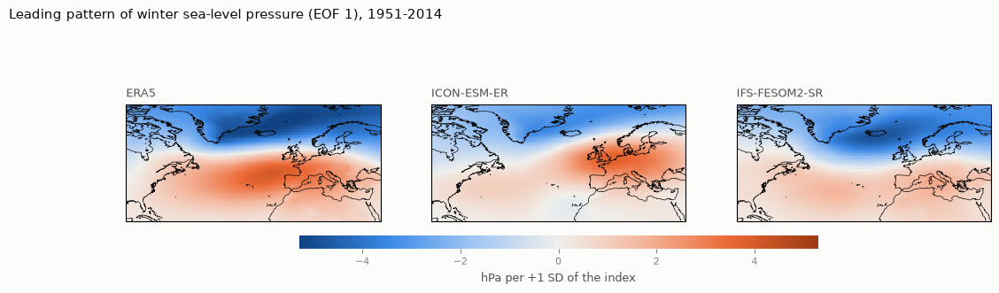
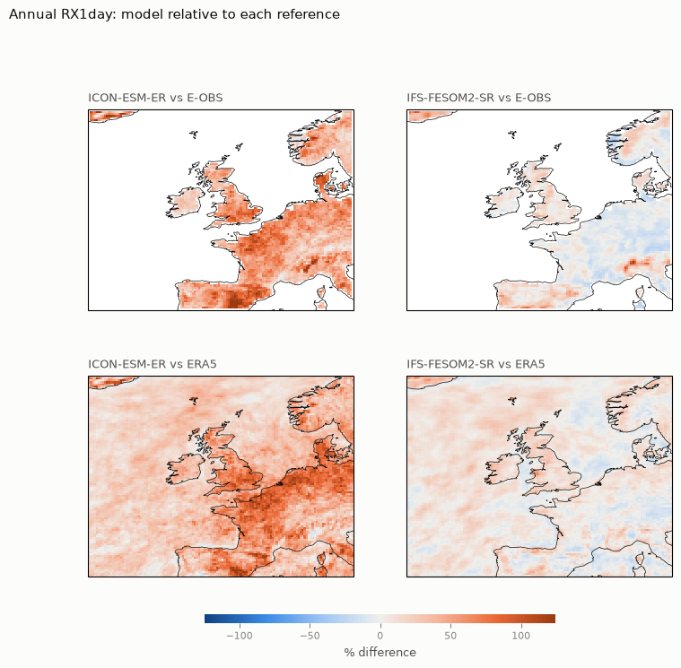
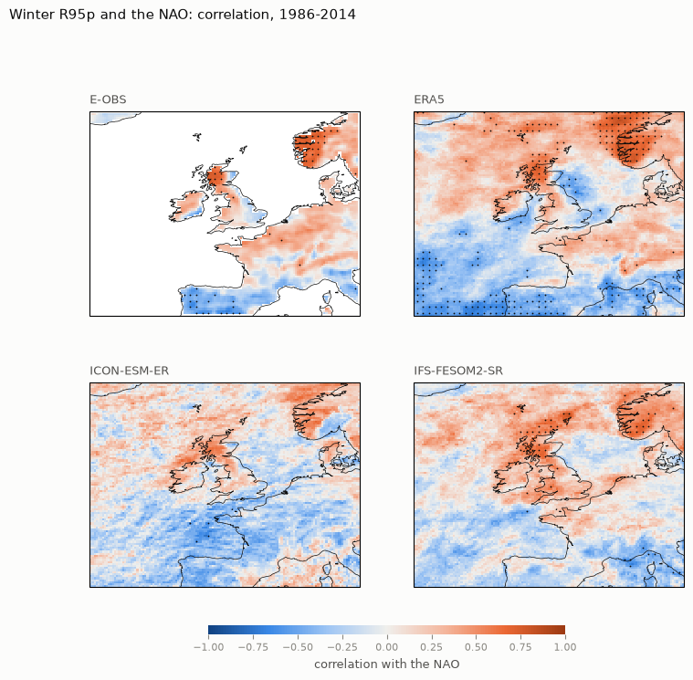
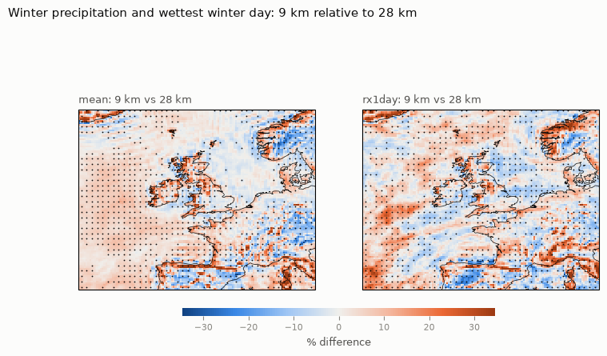
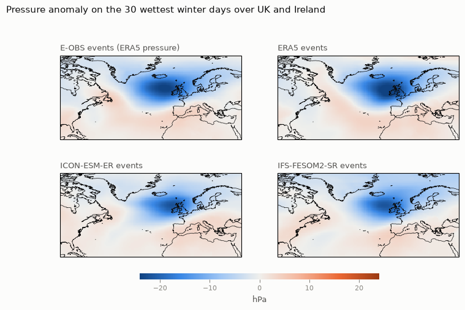
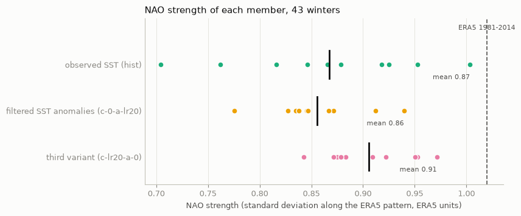

# HighRes-EERIE-NorthAtlantic-Evaluation

**How well do high-resolution climate models represent winter extremes over the UK and Ireland,
their atmospheric drivers, and how far can the conclusions be trusted?**

An exploratory analysis of public output from the EU project [EERIE](https://eerie-project.eu)
(European Eddy-Rich Earth System Models). Two coupled models, ICON-ESM-ER and IFS-FESOM2-SR, are
evaluated against the ERA5 reanalysis and the station-based E-OBS dataset, step by step: the mean
winter circulation, the North Atlantic Oscillation (NAO), precipitation and temperature extremes,
the link between the NAO and extremes, the weather behind the heaviest rain days, and how much the
conclusions depend on model resolution and on chance.

**Project website:** https://tunahim.github.io/HighRes-EERIE-NorthAtlantic-Evaluation/
(the findings in pictures, how the pipeline is built, and every notebook as a web page).

All data are public. All analysis code, tests and executed notebooks are in this repository.

> **Read this first.** Each coupled model is represented by a **single run** (member r1). Single
> runs carry their own chance weather, so the results below are indications, not a ranking of the
> models. The main contribution of the project is the **evaluation method and diagnostic
> pipeline**: a reproducible chain of tests that can be rerun on more members, more models, CMIP6
> and CMIP7 to give definitive answers.

---

## Key findings

*Exploratory results: two coupled models with one member each, so a shared result is described as
"consistent across the two models examined", not as robust.*

1. **The circulation sets up everything downstream.** ICON-ESM-ER's winter pressure is too low in
   the north and too high in the subtropics: its average winter looks like a permanent +2.3 SD
   positive NAO. The same bias reappears as a wet bias, as 50–60% too-heavy rain extremes over the
   UK and Ireland, and as a misplaced NAO rainfall response. IFS-FESOM2-SR's mean circulation is
   close to ERA5 and its rain extremes are within 10–20% of the references.
2. **Both models have a weaker NAO than the real world** (59% and 71% of ERA5's strength). Ten
   identical atmosphere-only runs show that a single run can vary between 70% and 100%, so part of
   this is chance; ICON-ESM-ER lies below that whole range.
3. **The NAO link to winter rain extremes is reproduced by IFS-FESOM2-SR** in sign, pattern and
   strength. ICON-ESM-ER has the right sign in the north, a weak link in Norway and the wrong sign
   over north-west France.
4. **Both models bring their heaviest UK winter rain through the right weather:** a deep low just
   north-west of the islands (pattern correlation 0.94–0.95 with ERA5). ICON-ESM-ER's storms show
   less build-up in the days before. Both models' storm tracks are 13–17% too active over the UK.
5. **Higher resolution is not automatically better.** In the same model with the same ocean,
   9 km instead of 28 km makes winter rain extremes 5–12% heavier: closer to observations over the
   mountains of western Norway, too heavy over the UK and Ireland. The conclusion about the NAO's
   influence does not change with resolution, but it varies strongly between identical runs
   (UK and Ireland correlation 0.04 to 0.33). **Internal variability matters as much as resolution.**
6. **The observations themselves carry uncertainty.** E-OBS and ERA5 agree on patterns but not
   always on numbers; for example the NAO link over the UK and Ireland has a correlation of 0.51 in
   E-OBS and 0.35 in ERA5.
7. **No detectable sensitivity of the NAO to small-scale sea-surface temperature** in two
   ten-member atmosphere-only ensembles (changes of −1% and +4%, well within the member spread).

---

## Figures

| | |
|---|---|
|  |  |
| **The NAO in ERA5 and both models** (notebook 04). Blue: lower pressure in a positive-NAO winter. | **Wettest day of the year, model relative to E-OBS** (notebook 05). Orange: too wet. |
|  |  |
| **Correlation of winter very-wet-day rain with the NAO** (notebook 06). Dots: significant after false-discovery-rate control. | **9 km relative to 28 km, same model and ocean** (notebook 08). Dots: outside the 28 km member range. |
|  |  |
| **Pressure anomaly on the 30 wettest winter days over the UK and Ireland** (notebook 09). | **NAO strength of every member of three ten-member ensembles** (notebook 07): the spread is chance. |

---

## Where to start

| If you have | Read |
|---|---|
| 5 minutes | this page and the figures above |
| 15 minutes | [`notebooks/00_summary.ipynb`](notebooks/00_summary.ipynb): the whole story in seven figures |
| a visual overview | the [project website](https://tunahim.github.io/HighRes-EERIE-NorthAtlantic-Evaluation/): what was done and found, and how the data gets from the data centre to the notebooks |
| your own questions | the [interactive explorer](https://tunahim.github.io/HighRes-EERIE-NorthAtlantic-Evaluation/explorer/): maps and yearly series of every extreme index, for each dataset and region, in the browser |
| an hour | the core notebooks below |

**Core story**

| Notebook | Question |
|---|---|
| [`03_validation_baseline`](notebooks/03_validation_baseline.ipynb) | Is the mean winter climate credible? |
| [`04_nao`](notebooks/04_nao.ipynb) | Is the NAO realistic in pattern and strength? |
| [`05_extremes`](notebooks/05_extremes.ipynb) | Are RX1day, TXx and R95p realistic? |
| [`06_nao_extremes`](notebooks/06_nao_extremes.ipynb) | Do the models link the NAO to extremes as the real world does? |
| [`08_resolution`](notebooks/08_resolution.ipynb) | Does 9 km resolution improve winter rain extremes over 28 km? |
| [`09_event_anatomy`](notebooks/09_event_anatomy.ipynb) | What weather brings the heaviest winter rain? |

**Background and checks**

| Notebook | Content |
|---|---|
| [`01_data_inventory`](notebooks/01_data_inventory.ipynb) | Which public EERIE data exist and can be read |
| [`02_download_plan`](notebooks/02_download_plan.ipynb) | Domains, datasets, periods, measured download cost, sample maps |
| [`07_paired_experiment`](notebooks/07_paired_experiment.ipynb) | NAO sensitivity to filtered sea-surface temperature |

Every notebook opens with a plain-language explanation of the terms it uses, has a note above every
code cell and a caption under every figure, and ends with findings, limitations and open questions.

---

## Data

| Source | Role | Period |
|---|---|---|
| ICON-ESM-ER, `hist-1950`, r1 (MPI-M) | coupled model, eddy-rich ocean | 1950–2014 monthly; 1985–2014 daily |
| IFS-FESOM2-SR, `hist-1950`, r1 (ECMWF, AWI) | coupled model, eddy-rich ocean | 1950–2014 monthly; 1985–2014 daily |
| IFS atmosphere-only, observed and filtered SST (ECMWF) | sensitivity experiment, 10 members at 28 km | 1980–2023 monthly |
| IFS atmosphere-only at 9 km and 28 km | resolution comparison (1 and 3 members) | 1985–2014 daily (28 km: winter) |
| ERA5 (Copernicus / ECMWF) | reanalysis reference | 1950–2014 monthly; 1985–2014 daily |
| E-OBS v33.0e (ECA&D) | station-based reference over land | 1985–2014 daily |

Model and ERA5 data are read from the DKRZ km-scale cloud (`eerie.cloud.dkrz.de`, Zarr over HTTPS);
E-OBS from the ECA&D distribution. Only regional cut-outs are kept (about 4 GB in total); the data
are not part of this repository and can be re-downloaded with the commands below.

**Domains.** North Atlantic (90°W–40°E, 20–80°N) for the NAO; north-west Europe (20°W–13°E,
40–65°N) for temperature, precipitation and extremes; UK and Ireland (11°W–2.5°E, 49–61°N) as the
headline region, with western Norway and north-west France as the wet and dry sides of the NAO
rainfall pattern.

**Why these data.** ICON-ESM-ER and IFS-FESOM2-SR are the only public EERIE coupled runs with all
the daily and monthly fields needed. IFS-NEMO-ER provides monthly fields only; the HadGEM3-GC5
resolution ladder requires a JASMIN login. The full reasoning is in
[`docs/methods.md`](docs/methods.md) and notebooks 01 and 02.

---

## Methods in brief

Fixed in [`docs/methods.md`](docs/methods.md) before results were produced.

- **Winter** is December–February, labelled by the year of its January.
- **NAO:** leading EOF of winter sea-level-pressure anomalies over the North Atlantic, √cos(latitude)
  weighting, sign fixed (positive = low near Iceland, high near the Azores). Models are also measured
  along the ERA5 pattern, and checked against a station-style Azores-minus-Iceland index.
- **Extremes (ETCCDI):** RX1day (wettest day), TXx (hottest day), R95p (total rain on days above the
  local 95th percentile of wet days, base period 1985–2014), each per year and per winter.
- **NAO-to-extremes link:** detrended correlation and regression maps, two-sided t-test with
  false-discovery-rate control across grid points (Wilks 2016), composites with bootstrap intervals.
- **Fair comparison:** all datasets on the same 0.25° grid; regional averages over the same land
  cells; units mm/day, °C and hPa.
- **Chance:** judged from the spread between ensemble members wherever members exist.

---

## How it is built

```
DKRZ cloud (STAC + Zarr) ─┐
ECA&D (E-OBS netCDF) ─────┼─► find ─► read, decode, cut, harmonise ─► local archive ─► analysis library ─► notebooks
public catalogues ────────┘   catalogue.py   download.py, grib.py, regions.py   store.py   nao, extremes, events, ...
```

- **Data layer** (`src/eerie_uk/`): `catalogue.py` lists and describes datasets; `download.py` cuts
  each year to the region in memory, converts units and saves compressed netCDF, with retries and
  resume; `grib.py` decodes the IFS GRIB chunks; `regions.py` handles regional cut-outs and regridding;
  `store.py` reads the archive back with common time stamps and units.
- **Analysis layer:** `climatology.py`, `nao.py`, `extremes.py`, `relationships.py`, `events.py`,
  `plotting.py`. Pure functions on xarray data: the same code runs on a model, a reanalysis or
  station data, and on one member or a whole ensemble.
- **Presentation layer:** `scripts/build_notebook_NN.py` generates each notebook, which is then
  executed top to bottom, so text, numbers and figures always come from the code.
- **Tests:** offline tests (`pytest`) on synthetic data with known answers, run automatically on
  GitHub for every push (`.github/workflows/tests.yml`).
- **Provenance:** every result table in `app_assets/` has a JSON file of the same name (and the
  same record inside the Parquet file) giving the code version (git commit), date, input datasets
  with their server version tags, period and method section.

A pictorial version, including how the pipeline would scale to more members, CMIP6/CMIP7 and
supercomputers, is in [`docs/engineering_overview.html`](docs/engineering_overview.html).

---

## Reproduce

```bash
conda env create -f environment.yml          # Python 3.11, xarray, dask, zarr, cartopy, ...
conda activate eerie-uk-nao
pytest                                       # offline tests

# download the regional cut-outs (about 4 GB on disk; much more is streamed)
set PYTHONPATH=src                           # Windows; on Linux/macOS: export PYTHONPATH=src
python -m eerie_uk.download --group monthly
python -m eerie_uk.download --group daily
python -m eerie_uk.download --group resolution
python -m eerie_uk.download --group pressure
python -m eerie_uk.eobs

# rebuild and execute every notebook (Windows PowerShell)
powershell -ExecutionPolicy Bypass -File scripts\build_all.ps1
```

Downloads resume where they stopped: each year is a separate file, and existing files are skipped.
The server sends whole-globe chunks, so the network traffic (roughly 250–300 GB for everything) is
far larger than what is kept; a connection without a data limit is needed.

---

## Repository layout

```
src/eerie_uk/      analysis and data-access library
notebooks/         executed notebooks 00–09
scripts/           notebook generators, findings text, build script
tests/             offline tests
docs/              methods, visual overviews, figures
app_assets/        small result tables (Parquet), each with a JSON provenance record
environment.yml    conda environment
data/              downloaded cut-outs (not in the repository)
```

---

## Limitations

- One member per coupled model; 64 winters for the NAO, 29 for the link to extremes.
- Two models only; model complexity is not tested.
- ERA5 precipitation is a model product; E-OBS smooths intense rain and covers land only.
- Reference data are regridded bilinearly, not conservatively.
- The resolution comparison uses one 9 km run and three 28 km members, winter only, at 25 km.
- The filter used in the sea-surface-temperature experiment ("LR20") is not documented publicly.
- Air quality is not analysed; persistent high pressure is used only as a circulation proxy.

---

## Data credits and terms

- **EERIE model output:** produced by the EERIE consortium (MPI-M, ECMWF, AWI and partners), served
  by DKRZ. ICON-ESM-ER data are licensed CC BY 4.0 by MPI-M; see each dataset's metadata for terms.
- **ERA5:** Hersbach et al. (2020), Copernicus Climate Change Service; served by DKRZ.
- **E-OBS:** Cornes et al. (2018), doi:10.1029/2017JD028200. Non-commercial research and education
  use only (ECA&D data policy). We acknowledge the E-OBS dataset and the data providers in the ECA&D
  project.

---

## Licence

Code: MIT (see [`LICENSE`](LICENSE)). Data remain under their providers' terms (above).

## Author

Himansu Kesari Pradhan. Exploratory project, 2026.
