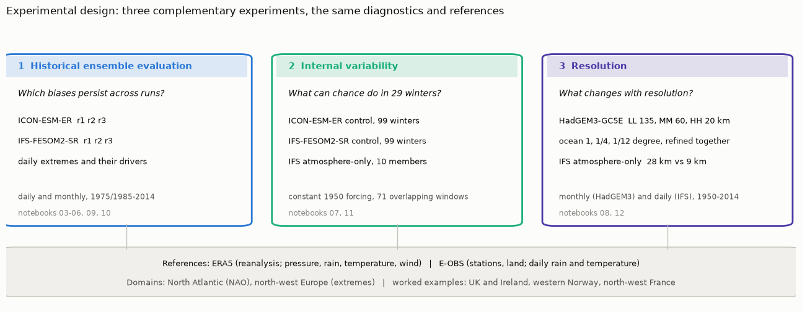

# Methods

Sections 1–8 were fixed on 9 October 2026, before any result was produced, for the analysis of
historical run r1. Section 9 lists checks added after the first results, and section 10 the
extension to three runs per coupled model, 100-year control runs and the HadGEM3-GC5E coupled
resolution configurations. Everything in this project is exploratory.

The project is organised in three experiments: **1 · historical ensemble evaluation** (notebooks 03–06,
09, 10), **2 · internal variability** (07, 11) and **3 · resolution** (08, 12).

| Experiment | Data | Time resolution | Purpose | Notebooks |
|---|---|---|---|---|
| 1 · Historical ensemble evaluation | ICON-ESM-ER and IFS-FESOM2-SR, r1–r3; ERA5, E-OBS | daily and monthly | which biases persist across runs | 03–06, 09, 10 |
| 2 · Internal variability | control runs of both models (99 winters); IFS atmosphere-only ensembles | monthly and daily rain | what chance alone can do in 29 winters | 07, 11 |
| 3 · Resolution | HadGEM3-GC5E LL / MM / HH; IFS atmosphere-only 28 and 9 km | monthly (HadGEM3), daily (IFS) | what changes with resolution | 08, 12 |

| Kind | Where |
|---|---|
| **Primary methods** | sections 2–5 (preprocessing, NAO, extremes, NAO-to-extremes link) and section 10 (members, control windows, resolution) |
| **Sensitivity checks** | section 9 (bootstrap, leave-one-winter-out, effective sample size, circulation decomposition, EOF domain) and the control-run stability check (section 10) |
| **Limitations** | section 1 (scope), the "Limitations" section of every notebook and of the README |

## 1. Wording and scope

- **ERA5** is a reanalysis reference, not direct observations.
- **E-OBS** is a station-based gridded observational dataset.
- **ICON-ESM-ER and IFS-FESOM2-SR** are evaluated with three historical members each (r1, r2,
  r3), together with their 100-year control runs. The detailed process analyses (notebooks
  03–09) use run r1; notebook 10 repeats their headline diagnostics on r2 and r3.
- **HadGEM3-GC5E** is evaluated separately, with one member at each of three coupled
  atmosphere–ocean resolution configurations (LL, MM, HH) and monthly output only, so no
  daily-extreme conclusions are drawn from it.
- A result found in all three sampled historical members is described as **consistent across
  the three sampled members**, not as an ensemble-robust result; three members cannot exclude a
  different answer in a fourth. A result found in both models' r1 runs only is "consistent
  across the two models examined".
- The control-run windows overlap and are not independent samples. Their distributions are
  empirical estimates of internal variability, not formal probability distributions.
- Changes across the HadGEM3-GC5E configurations are interpreted as coupled atmosphere–ocean
  resolution sensitivity, not as isolated atmospheric-resolution effects.
- The paired atmosphere-only runs test "atmospheric sensitivity to small-scale SST variability
  (LR20-filtered SST forcing)", not coupled ocean-eddy feedbacks; the LR20 filter itself is
  not publicly documented.

## 2. Preprocessing

| Item | Choice |
|---|---|
| Units | precipitation mm/day, temperature °C, pressure hPa |
| Calendars | checked per source and aligned by date |
| Grid | common 0.25° model grid; ERA5 and E-OBS are regridded to it |
| Regridding | temperature and pressure bilinear. Precipitation should be conservative; the prototype uses bilinear because conservative regridding needs an extra package. This slightly smooths precipitation maxima and is stated wherever it matters. |
| Winter | December belongs to the following year's winter: DJF 1986 = December 1985 + January and February 1986. Incomplete first and last winters are dropped. |

Files on disk hold temperature in K; it is converted to °C when loaded.

## 3. NAO (notebook 04)

1. Monthly sea-level pressure minus the 1950–2014 mean of each calendar month
   gives anomalies.
2. Select December–February and average per complete winter. For the 1950–2014
   monthly data this gives 64 winters (1951–2014); the incomplete winter of
   January–February 1950 is dropped. The monthly winter series is kept as well.
3. Domain 20–80°N, 90°W–40°E. Multiply by √cos(latitude) before the EOF.
4. Leading EOF per dataset; report explained variance and pattern correlation
   with the ERA5 leading EOF.
5. Sign: a positive NAO has negative loading near Iceland (about 65°N, 20°W) and
   positive loading near the Azores (about 38°N, 25°W). Flip the EOF and its
   principal component if needed.
6. Index: leading principal component divided by its 1950–2014 standard
   deviation.
7. Also project each model's anomalies onto the ERA5 leading EOF, to compare on
   a common basis. *NAO strength* is the standard deviation of this projected
   series divided by the standard deviation of ERA5's own projected series: the
   same reference pattern and the same amplitude scale for every dataset. It is
   not the variance explained, and not each dataset's own standardised index
   (which has a standard deviation of 1 by construction).
8. Cross-check against a station-style index, Azores minus Iceland pressure;
   report the correlation with the EOF index.
9. Diagnostics: year-to-year standard deviation, lag-1 winter autocorrelation,
   linear trend with confidence interval. Spectrum optional.

## 4. Extremes (notebook 05)

Per grid cell on the 0.25° grid, base period 1985–2014.

| Index | Definition | Computed for |
|---|---|---|
| RX1day | largest daily precipitation | year and DJF |
| TXx | highest daily maximum temperature | year (usually summer) and DJF |
| R95p (after ETCCDI R95pTOT) | A wet day has at least 1 mm. R95p is the total precipitation on days above a threshold (the whole daily total, not the excess). For the annual index the threshold is the 95th percentile of all wet days at the cell over 1985–2014, as in ETCCDI. For the winter index a separate, winter-specific threshold is used: the 95th percentile of DJF wet days only. This seasonal version is an adaptation, not the standard ETCCDI index. Thresholds are computed separately for each dataset, so each is judged against its own very-wet-day level. Also reported as a percentage of total wet-day precipitation. | year and DJF |

The threshold is estimated from the same years it is applied to, which biases
exceedance counts slightly inside the base period (Zhang et al. 2005). This is
stated once and not corrected.

Model against reference: climatology and difference maps, and land-only regional
means. UK and Ireland is mandatory; western Norway and north-west France are
supporting.

## 5. NAO to extremes (notebook 06)

- The winter NAO is related only to winter indices: DJF RX1day, DJF R95p,
  DJF TXx. Annual TXx stays in notebook 05.
- Primary method: grid-point correlation, and regression per one standard
  deviation of NAO, over 1986–2014 (29 complete winters), with both series linearly
  detrended.
- Significance: two-sided t-test at 5%, with false-discovery-rate control across
  grid points (Wilks 2016).
- Supporting method: composites of positive-NAO minus negative-NAO winters
  (upper and lower thirds, about ten winters each) with bootstrap confidence
  intervals.
- Key question: does each model reproduce the sign, pattern and strength of the
  link in ERA5 and E-OBS (pattern correlation, regional regression)?
- The sample size is stated once.

## 6. Paired experiment (notebook 07, optional, NAO only)

The same NAO method over 1980–2023, per member. Differences are judged against
the spread across members (10 members at 28 km). At most half a day is spent
verifying LR20.

## 7. Checks before claims

The IFS-FESOM2-SR GRIB decoding fix is checked in notebook 03:

1. decode the same message with a plain reader where possible and compare;
2. compare the monthly mean of decoded daily data with the model's monthly file;
3. check minimum, maximum, mean and the spatial pattern.

## 8. Priorities

Core: notebooks 03 → 04 → 05 → 06 (run r1), then 10, 11 and 12 (three runs, control runs,
resolution). Supporting: 07, 08, 09. The explorer shows historical run r1 only.

## 9. Additions after the first results (notebook 06, sections 10 and 11; notebook 04, section 8)

Added on 5 November 2026, after the results above were produced, to test how far they hold.
They do not change any earlier choice.

| Check | Method |
|---|---|
| Uncertainty of a regional correlation | Bootstrap: 5000 resamples of the 29 winters with replacement, NAO and extreme value kept together; the 2.5th and 97.5th percentiles give the 95% interval. Series detrended first. |
| Influence of single winters | Correlation recomputed 29 times, each time without one winter; the range and the most influential winter are reported. |
| Memory between winters | Effective sample size n(1 − a·b)/(1 + a·b), with a and b the lag-1 autocorrelations of the two series (Bretherton et al. 1999), never above n; p value recomputed with it. |
| Model against reference | Fisher z test for two correlations from independent samples (29 winters each). Not applied between E-OBS and ERA5, which describe the same winters. |
| Circulation part of a mean bias | Observed regression of the index on the NAO (per +1 SD of the ERA5 NAO, from E-OBS or ERA5) × the model's mean winter sea-level-pressure bias projected onto the ERA5 NAO pattern (in ERA5 SD, 1986–2014). Compared with the actual mean bias over UK and Ireland land and as a land pattern correlation. Repeated with the model's own regression as a sensitivity test. Linear; a consistency diagnostic, not an attribution. |
| EOF domain sensitivity (notebook 04, section 8; added 10 November 2026) | The EOF analysis repeated in five North Atlantic boxes (standard 20–80°N 90°W–40°E; 20–70°N 90°W–40°E; 25–75°N 80°W–30°E; 20–80°N 90°W–0°; 30–80°N 60°W–40°E). Separation of the first two EOFs by non-overlapping North et al. (1982) error bars; NAO strength along each box's ERA5 pattern. |
| Wet-day frequency and intensity | Winter wet days (at least 1 mm; ETCCDI R1mm) and rain per wet day (ETCCDI SDII), UK and Ireland land, 1986–2014. |

## 10. Three runs, control runs and coupled resolution (notebooks 10, 11 and 12; added 14–15 November 2026)

| Item | Method |
|---|---|
| Extra members | ICON-ESM-ER and IFS-FESOM2-SR `hist-1950` r2 and r3, processed exactly as r1. NAO compared over the common winters 1976–2014 (anomalies relative to 1975–2014); extremes over 1986–2014. IFS-FESOM2-SR r3 has no data for 2–31 October 1999 on the server; winter results are unaffected. |
| Consistent across the three sampled runs | All three runs agree in sign and roughly in size. Not a full uncertainty estimate. |
| Control runs | `eerie-control-1950` (constant 1950 forcing), 99 winters 1951–2049. NAO along the ERA5 pattern relative to the run's own 100-year winter mean; winter RX1day and R95p from daily rain with a threshold from all 100 winters. Every 29-winter window (71, overlapping); "chance range" = empirical 5th to 95th percentile across these overlapping windows, not a formal probability interval. Series detrended within each window. The ranges understate chance (about three independent windows per run). |
| HadGEM3-GC5E resolution ladder | HadGEM3-GC5E LL / MM / HH `historical` r1, monthly, from CEDA. Interpolated bilinearly onto the 1° (pressure, wind) and 0.25° (rain, temperature) grids, with edge cells filled from the nearest source cell. RMS pressure error cosine-weighted. NAO strength also given for 1951–1982 and 1983–2014 separately. |
| Jet latitude | Winter 850 hPa zonal wind averaged over 60°W–0°, latitude of its maximum between 15° and 75°N in each winter (after Woollings et al. 2010). ERA5 and HadGEM3 LL and MM. |

## References

- Bretherton, C. S., et al. (1999). The effective number of spatial degrees of freedom of a
  time-varying field. *J. Climate*, 12, 1990–2009.
- Cornes, R. C., et al. (2018). An ensemble version of the E-OBS temperature and
  precipitation data sets. *J. Geophys. Res. Atmos.*, 123. doi:10.1029/2017JD028200
- North, G. R., et al. (1982). Sampling errors in the estimation of empirical orthogonal
  functions. *Mon. Wea. Rev.*, 110, 699–706.
- Wilks, D. S. (2016). "The stippling shows statistically significant grid
  points". *Bull. Amer. Meteor. Soc.*, 97, 2263–2273.
- Woollings, T., A. Hannachi and B. Hoskins (2010). Variability of the North Atlantic eddy-driven
  jet stream. *Q. J. R. Meteorol. Soc.*, 136, 856–868.
- Zhang, X., et al. (2005). Avoiding inhomogeneity in percentile-based indices of
  temperature extremes. *J. Climate*, 18, 1641–1651.
